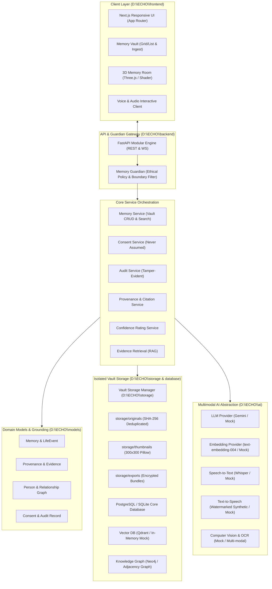

# ECHO System Architecture

## Evidence-Grounded, Privacy-Preserving Multimodal AI for Interactive Digital Memory Preservation

### 1. Architectural Philosophy
ECHO is designed as a multimodal memory preservation architecture that binds personal memories, historical documents, audio recordings, and kinship relationships into an evidence-grounded digital twin.

Unlike generative systems that hallucinate conversational personas, ECHO strictly adheres to the principle of **Evidence-Grounded Representation**:
> **Core Tenet**: Every assertion made by the system must be linked to an authenticated primary archival artifact or explicitly flagged as an unverified/unknown inference.

---

### 2. High-Level System Architecture

---

### 3. Vault Storage Subsystem (`D:\ECHO\storage`)

The Phase 2 Memory Vault isolates all files into structured subdirectories:
- `originals/`: Original uncompressed evidence files, keyed by `{sha256}_{sanitized_name}`.
- `processed/`: Processed multimodal derivatives (Phase 3).
- `thumbnails/`: 300x300 image thumbnails for fast UI rendering.
- `temporary/`: Scratch processing buffers, cleaned immediately upon completion.
- `exports/`: Secure archival JSON and media export packages.
- `local/`: SQLite databases (`echo_dev.db`) and local runtime artifacts.

#### Security & Integrity Rules:
1. **Path Traversal Shield**: Paths are checked with `.resolve()` and must strictly remain inside `D:\ECHO\storage`. Traversal sequences (`../`, null bytes) raise `MaliciousPathError`.
2. **Duplicate Detection**: SHA-256 digests prevent duplicate physical file blocks.
3. **Zero Physical Exposure**: Internal physical paths (`D:\...`) are never transmitted in API responses or exports.

---

### 4. Tri-State Confidence Calibration
- **GREEN (VERIFIED)**: Substantiated by primary authenticated physical documents or audio recordings.
- **YELLOW (SUPPORTED INFERENCE)**: Plausible deductions drawn from correlated preserved memories.
- **RED (UNKNOWN / UNSUPPORTED)**: Unrecorded claims; explicitly acknowledged as unknown with zero parametric hallucination.

---

### 5. Ethical Safeguards & Consent Architecture
- **Consciousness Rejection**: Strict real-time regex filters reject prompts requesting simulation of living sentience, heaven, or resurrection.
- **Explicit Consent**: `MEDIA_PROCESSING`, `AI_PROCESSING`, `VOICE_PROCESSING`, `AVATAR_PROCESSING`, and `FAMILY_ACCESS` require explicit unrevoked grants.

---

### 6. Phase 3 Multimodal AI Processing Subsystem
The Phase 3 processing pipeline transforms raw uploaded multimedia into structured, traceable evidence records:
- **Modular Processors**: `ImageProcessor`, `AudioProcessor`, `VideoProcessor`, `DocumentProcessor`, `OCRService`, `TranscriptionService`, `MetadataService`, `EntityExtractor`, `EventExtractor`, and `ProcessingOrchestrator`.
- **Atomic Evidence Model**: 14 Evidence Types (`TEXT`, `OCR_TEXT`, `TRANSCRIPT`, `IMAGE_METADATA`, `VISUAL_OBJECT`, `VISUAL_SCENE`, `VIDEO_KEYFRAME`, `ENTITY`, `EVENT`, `LOCATION`, `DATE`, `AUDIO_METADATA`, `VIDEO_METADATA`, `DOCUMENT_METADATA`).
- **Four-Tier Provenance Taxonomy**: `DIRECTLY_OBSERVED`, `USER_PROVIDED`, `AI_INFERRED`, `UNKNOWN`.
- **Asynchronous Orchestration**: Gated by consent checks (`MEDIA_PROCESSING`, `AI_PROCESSING`), tracking state (`PENDING`, `PROCESSING`, `COMPLETED`, `FAILED`, `REVIEW_REQUIRED`), retry count, and research latency metrics.
- **Downstream Preparation**: Prepares atomic evidence for Phase 4 Knowledge Graph ingestion and Vector RAG without implementing RAG or Memory DNA prematurely.

---

### 7. Phase 4 Memory DNA, Knowledge Graph & Vector Retrieval Subsystem
Phase 4 constructs the structured intelligence foundation transforming Phase 3 evidence into retrievable knowledge:
- **Memory DNA**: Structured evidence-grounded representation of 22 life categories (Identity, Education, Career, Family, Places, Milestones, Values). Versioned deterministically (`MemoryDNAVersion`) to preserve historical audit states. Missing fields strictly remain `UNKNOWN`.
- **Knowledge Graph**: 10 node types (`PERSON`, `MEMORY`, `EVENT`, `PLACE`, `OBJECT`, `DOCUMENT`, `MEDIA`, `ORGANIZATION`, `DATE`, `TOPIC`) and directed evidenced relationships. Production-ready for Neo4j with `LocalGraphStore` zero-dependency fallback. Strictly prohibits inferring relations purely from document co-occurrence.
- **Conservative Entity Resolution**: Normalizes titles and honorifics while registering unconfirmed aliases. Strictly prohibits silent merging of candidate entities.
- **Contradiction Tracking**: Captures and logs conflicting factual claims (`ContradictionRecord`) across heterogeneous records for guardian review.
- **Vector Indexing & Chunking**: Preserves exact character offsets and metadata traceability across all chunks. Operates via Qdrant interface with `LocalVectorStore` fallback.
- **Explainable Hybrid Retrieval**: Synthesizes Vector, Keyword, and Graph retrieval with explainable score breakdowns and `why_retrieved` rationales. Enforces backend authorization and privacy filters before returning results.

---

### 8. Phase 5 Conversational Engine, Memory Guardian & Evidence-Grounded RAG
Phase 5 implements the natural language conversational dialogue and ethical gating layer:
- **Evidence-Grounded RAG Pipeline**: Connects Question Classification, Privacy/Consent authorization, Memory DNA, Knowledge Graph, and Vector Retrieval into a strict evidence-bound context window.
- **Strict Anti-Fabrication (`DO_NOT_INVENT = True`)**: If evidence is missing, the system strictly outputs `"I don't have enough information in the preserved archive to answer that accurately."` with `UNKNOWN` confidence and `NO_SUPPORTING_EVIDENCE` rationale.
- **Memory Guardian (18-Check Audit)**: Inspects all candidate outputs for unsupported claims, hallucinations, first-person identity usurpation, unacknowledged contradictions, and consent revocations, issuing `PASS`, `REVISE`, `BLOCK`, or `UNKNOWN`.
- **Claim Extraction & Evidence Mapping**: Sentence-level parsing decomposes candidate responses into discrete subject-predicate-object claims and maps them to supporting evidence chunks.
- **Confidence Engine**: Derives explainable tri-state ratings (`VERIFIED`, `SUPPORTED_INFERENCE`, `UNKNOWN`) through weighted claim verification with contradiction penalties.
- **Provenance Engine**: Generates clickable source citations with obfuscated paths concealing physical filesystem locations.
- **Revision Loop Boundary**: Exactly one automatic revision loop with stricter instructions is allowed before falling back to safe constraints.

