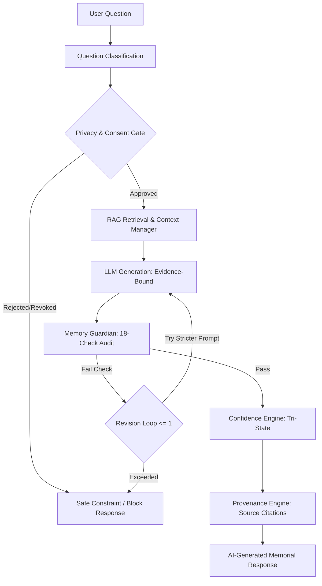

# ECHO Conversational Engine Architecture

## Overview
The **ECHO Conversation Engine** provides an evidence-grounded, privacy-preserving dialogue intelligence layer for interactive digital memory preservation. Designed under strict memorial boundary guidelines, ECHO enables authorized family members and researchers to query preserved life archives without simulating consciousness, fabricating subjective experiences, or usurping the identity of the deceased.

---

## Core Principles

1. **Evidence Grounding Only**: Every factual proposition must be backed by retrieved archive items (Memory DNA, Knowledge Graph nodes, OCR text, audio transcripts, or verified user contributions).
2. **Strict Non-Fabrication (`DO_NOT_INVENT = True`)**: If evidence is missing, the engine strictly outputs:
   > *"I don't have enough information in the preserved archive to answer that accurately."*
   Creative extrapolation, speculative gap-filling, and fictional dialogue are strictly prohibited.
3. **Mandatory Third-Person Memorial Boundary**: The AI assistant never speaks as the deceased person (`"I remember"`, `"When I was alive"`, `"I miss you"`). All responses explicitly state:
   > *"The preserved archive indicates..."* or *"According to documented records..."*
4. **Transparent Provenance**: Every response provides clickable, verified source citations concealing raw filesystem paths.
5. **AI-Generated Labeling**: Every response carries the prominent banner `AI-GENERATED MEMORIAL RESPONSE`.

---

## Conversational Lifecycle

### 1. Multi-Turn Session Management
Sessions (`ConversationSession`) are tracked with:
- `session_id`: Unique session UUID.
- `memorial_profile_id`: Scoped profile identifier.
- `user_id`: Authenticated user UUID.
- `title`: Dynamic session title.
- `messages`: Chronological list of `ConversationMessage` objects.

### 2. Context Window Assembly
Context is limited to a strict token budget and curated from three tiers:
- **Tier 1: Memory DNA**: Core verified identity attributes, validated timeline landmarks, and verified preferences.
- **Tier 2: Knowledge Graph**: Explicit entity relations (kinship, affiliations, co-occurrences).
- **Tier 3: Vector & Keyword Evidence Chunks**: High-scoring semantic chunks with relevance scoring >= threshold.

---

## Architectural Components

| Component | Service File | Function |
|---|---|---|
| **Question Classifier** | `question_classifier.py` | Distinguishes 14 query types (Memory, Relationship, Greeting, Unsupported, Sensitive). |
| **Prompt Engine** | `prompt_engine.py` | Builds strict evidence-bounded system prompts and correction prompts. |
| **Context Manager** | `context_manager.py` | Assembles multi-source evidence under token budget with deduplication. |
| **Claim Extractor** | `claim_extractor.py` | Extracts subject-predicate-object claims and maps them to evidence chunks. |
| **Hallucination Detector** | `hallucination_detector.py` | Flags first-person usurpation, unsupported years, and unevidenced assertions. |
| **Memory Guardian** | `memory_guardian.py` | 18-check validation engine deciding `PASS`, `REVISE`, `BLOCK`, or `UNKNOWN`. |
| **Confidence Engine** | `confidence_engine.py` | Computes tri-state rating (`VERIFIED`, `SUPPORTED_INFERENCE`, `UNKNOWN`). |
| **Provenance Engine** | `provenance_engine.py` | Generates clickable citations while obfuscating internal file paths. |
