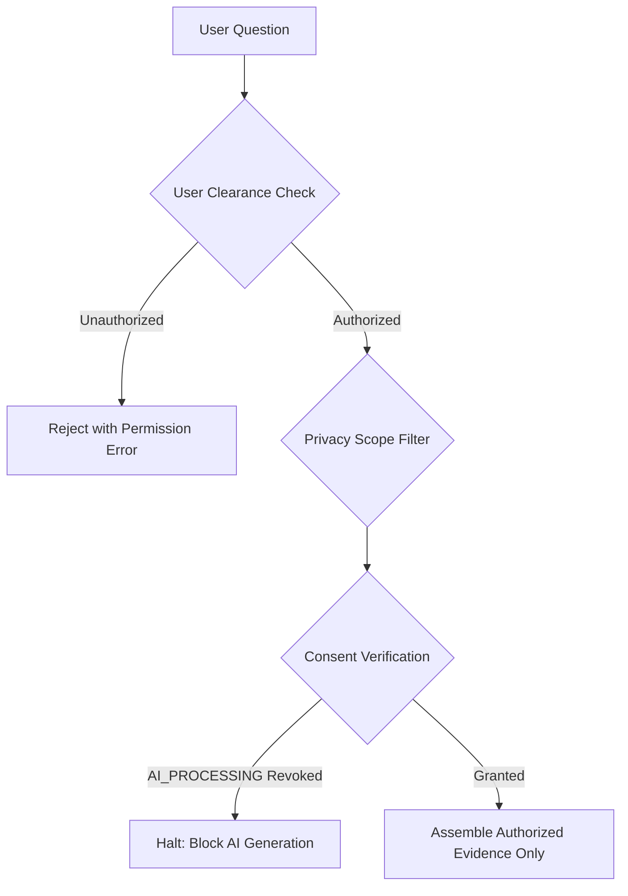

# Conversational Privacy, Consent & Boundary Security

## Overview
ECHO enforces privacy and family consent **before retrieval and context construction**, ensuring that private, restricted, or unconsented records are never transmitted to LLM providers or exposed in conversational sessions.

---

## Pre-Retrieval Authorization Enforcement

1. **Clearance Scoping**:
   - `PUBLIC`: Accessible by all verified memorial visitors.
   - `FAMILY`: Accessible only by authenticated family members.
   - `PRIVATE`: Accessible strictly by the primary custodian or memorial owner.
   - **Cross-user leakage prevention**: Queries run by unauthorized users are strictly scoped to public or family-cleared records.

2. **Consent Gating (`AI_PROCESSING`)**:
   - Memorial profile custodians can selectively grant or revoke `AI_PROCESSING` consent at any time via `backend/app/services/consent_service.py`.
   - If `AI_PROCESSING` consent is revoked:
     - All LLM retrieval and response generation is immediately blocked.
     - The system returns:
       > *"AI response generation is disabled because AI_PROCESSING consent is absent or revoked for this memorial archive."*
     - The Memory Guardian returns `BLOCK` under reason `CONSENT_REVOKED`.

---

## Sensitive Domain Protections
The system enforces strict safeguards preventing ungrounded speculation in protected areas:
- Medical diagnoses and mental health conditions
- Criminal or police interactions
- Intimate sexual orientation and private relationships
- Religious and political affiliations

If evidence exists and is authorized for display, it is cited objectively. If evidence does not exist, the system declines speculation and records the query in audit trails.
