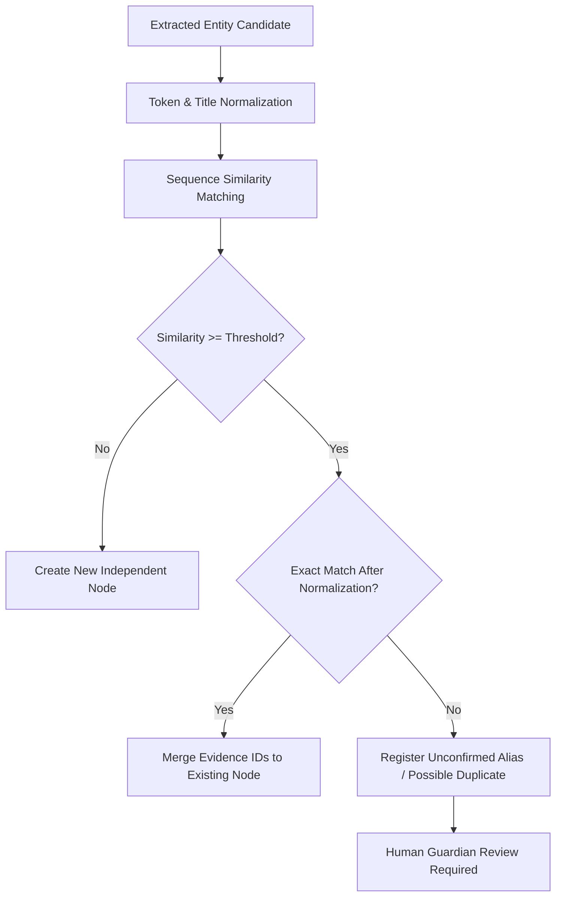

# Conservative Entity Resolution in ECHO

## 1. Principles & Objectives

Entity Resolution in personal digital memory preservation differs fundamentally from general web scraping:
- **Zero Hallucinated Merges**: Two people named "John Smith" (e.g. father and son) must never be merged accidentally.
- **Title & Honorific Normalization**: Variations such as `"Dr. Arun Kumar"`, `"Arun Kumar"`, and `"Prof. Arun Kumar"` should be identified as potential matches.
- **Unconfirmed Alias Registration**: Potential duplicates are marked as candidates for explicit guardian confirmation, never deleted or overwritten silently.

---

## 2. Resolution Workflow

---

## 3. Data Integrity Guarantee

If ambiguity exists between two candidate records:
- Both nodes remain distinct in the Knowledge Graph.
- An `EntityAlias` entry is created with `is_confirmed = False` and `is_possible_duplicate = True`.
- No historical data is destroyed.
