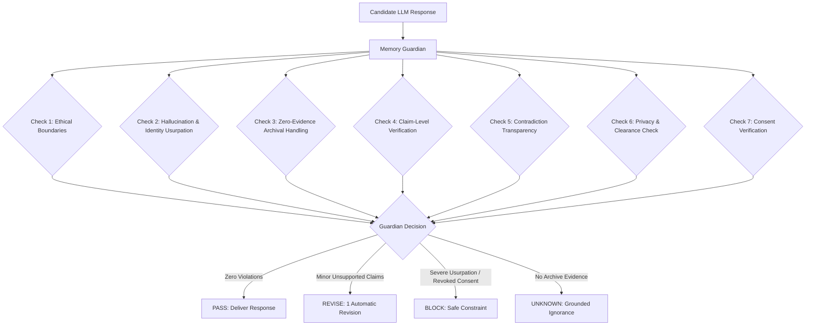

# Memory Guardian Architecture & Verification System

## Executive Summary
The **Memory Guardian** (`backend/app/services/memory_guardian.py`) is the central safety, evidentiary, and boundary-enforcement layer in ECHO. It audits every candidate conversational response before user delivery. If any statement violates archival grounding, privacy policies, consent terms, or ethical memorial boundaries, the Guardian intervenes to revise, constrain, or block the output.

---

## The 18 Guardian Verification Checks

| Check # | Verification Domain | Operational Rule |
|---|---|---|
| **1** | Unsupported Claims | Verifies each claim maps to at least one corroborating evidence ID. |
| **2** | Hallucinations | Flags facts, events, and biographical claims absent from retrieved context. |
| **3** | Missing Evidence | Prevents speculative completion of missing records. |
| **4** | Contradictions | Enforces explicit disclosure when archival records conflict. |
| **5** | Identity Uncertainty | Rejects ambiguous identity attribution. |
| **6** | Confidence Mismatch | Rejects claiming `VERIFIED` when evidence is speculative. |
| **7** | Provenance Mismatch | Ensures cited sources match actual indexed items. |
| **8** | Sensitive Information | Prohibits unverified inferences in protected domains (health, intimate). |
| **9** | Privacy Clearance | Enforces `PRIVATE` and `FAMILY` access control before delivery. |
| **10** | Consent Gating | Verifies active, unrevoked `AI_PROCESSING` consent. |
| **11** | AI-Generated Labeling | Validates presence of `AI-GENERATED MEMORIAL RESPONSE` banner. |
| **12** | Unsupported Emotional Claims | Prevents claiming undocumented emotions or spiritual states. |
| **13** | False First-Person Claims | Strictly blocks first-person usurpation (`"I loved"`, `"When I died"`). |
| **14** | Invented Memories | Blocks synthetic memory generation. |
| **15** | Invented Relationships | Prohibits claiming unrecorded family or personal bonds. |
| **16** | Invented Dates | Verifies all temporal mentions (years, decades) match archival text. |
| **17** | Invented Locations | Verifies all geographical locations exist in retrieved evidence. |
| **18** | Invented Preferences | Blocks stating favorite foods, music, or hobbies without evidence. |

---

## Guardian Decision States

1. **`PASS`**: All 18 evidentiary, privacy, and ethical boundary checks passed. Delivered directly.
2. **`REVISE`**: Minor unsupported claims or tone discrepancies detected. Triggers maximum **1 automatic revision** with stricter constraints.
3. **`BLOCK`**: Severe ethical boundary breach, revoked consent, or uncorrectable first-person usurpation.
4. **`UNKNOWN`**: Retrieval returned zero evidence. System outputs grounded statement of missing information.

---

## Revision Loop Boundary
- Maximum automatic revision attempts: **1**.
- If the revised draft still fails the audit:
  - Fallen back to **`SAFE UNKNOWN`** or **`BLOCK`**.
  - Infinite generation loops are strictly prevented.
