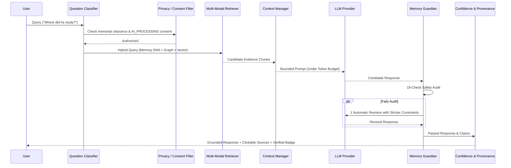

# Evidence-Grounded RAG Pipeline

## Architectural Overview
ECHO implements a multi-stage **Retrieval-Augmented Generation (RAG)** pipeline designed specifically for memorial archives. Unlike generic LLM RAG pipelines, ECHO strictly binds all generated tokens to retrieved evidence, enforcing that missing evidence yields explicit statements of uncertainty rather than plausible inventions.

---

## 1. Query Normalization & Classification
Each query is parsed and classified into one of 14 categories:
- `MEMORY_LOOKUP`: Archival inquiry on specific memories.
- `PERSON_LOOKUP`: Entity resolution on persons.
- `EVENT_LOOKUP` / `TIMELINE_LOOKUP`: Chronological and location-based milestones.
- `RELATIONSHIP_LOOKUP`: Kinship and social network queries.
- `MEDIA_LOOKUP` / `DOCUMENT_LOOKUP`: Source artifacts (photos, letters, audio).
- `PREFERENCE_LOOKUP`: Documented hobbies, tastes, and interests.
- `LIFE_STORY`: Broad biographical queries.
- `GENERAL_GREETING`: Non-memorial conversational courtesy.
- `GENERAL_INFORMATION`: Non-memorial general facts.
- `UNSUPPORTED_PERSONAL_QUERY`: Prohibited queries (what would they say today, are they in heaven, do they feel).
- `SENSITIVE_QUERY`: Gated medical, criminal, or intimate queries.
- `UNKNOWN`: Fallback.

---

## 2. Multi-Source Context Assembly
Context is gathered without leaking restricted materials:
1. **Memory DNA Items**: Core identity keys, verified traits, and verified milestones.
2. **Knowledge Graph Context**: Graph traversal triples (`Subject -> Predicate -> Object`).
3. **Vector & Keyword Chunks**: BM25 and dense vector matches scored with explainable components.

### Explainable Evidence Scoring
$$\text{FinalScore} = w_{\text{sem}} \cdot S_{\text{semantic}} + w_{\text{kw}} \cdot S_{\text{keyword}} + w_{\text{graph}} \cdot S_{\text{graph}} + w_{\text{prov}} \cdot S_{\text{provenance}} + w_{\text{conf}} \cdot S_{\text{confidence}}$$

---

## 3. Strict Anti-Fabrication (`DO_NOT_INVENT = True`)
When retrieval produces no relevant evidence chunks meeting the relevance threshold:
- **No LLM generation is attempted.**
- The system returns immediately:
  > *"I don't have enough information in the preserved archive to answer that accurately."*
- Confidence is set to `UNKNOWN_UNSUPPORTED` (Red indicator).
- Guardian decision is set to `PASS` under the `NO_SUPPORTING_EVIDENCE` rationale.
